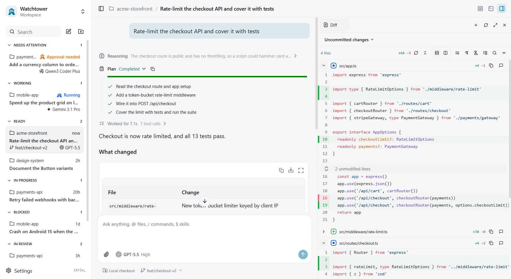
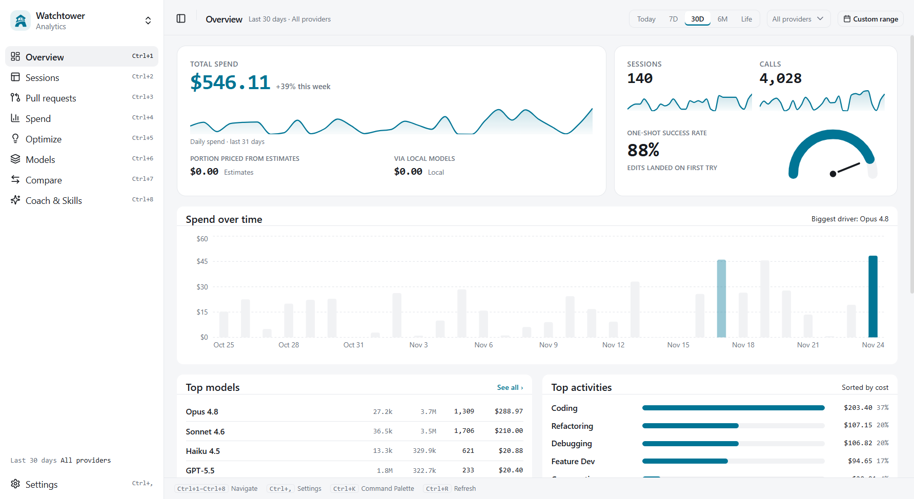
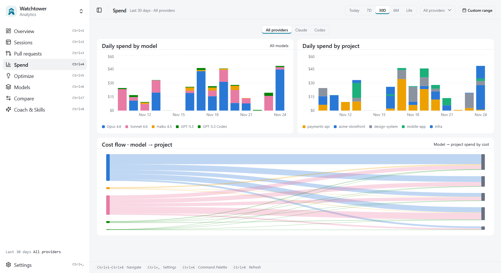
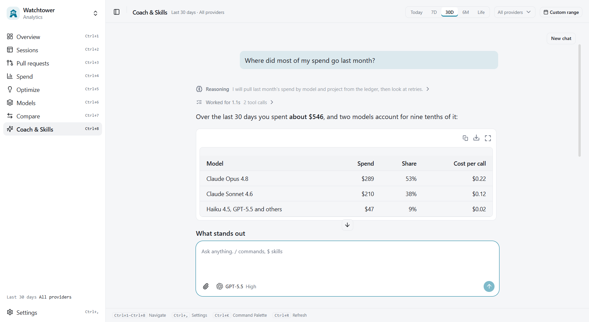

<div align="center">


# Watchtower

### Every coding agent, one desktop workspace.

Run Claude Code, Codex, Gemini CLI and 11 more agents on your local projects, review what they change,\
and see what every session costs. All of it local, with no account and no telemetry.

[](https://github.com/Pasquale-Favella/watchtower/releases/latest)
[](LICENSE)
[](#install)
[](#data--privacy)

**[Download for your platform](#install)** · [Quick start](#quick-start) · [Features](#features) · [Supported tools](#supported-tools) · [Privacy](#data--privacy) · [FAQ](#faq) · [Docs](#documentation)

</div>

<p align="center">
<picture>
  <source media="(prefers-color-scheme: dark)" srcset="assets/screenshots/workspace-dark.png" />
  
</picture>
</p>

## Why Watchtower

Coding agents live in a dozen separate CLIs, each with its own login, its own session format and its own idea of what happened. Watchtower gives them one home:

- **Run them.** Chat with any of 14 agents in your real projects. Every chat gets its own terminals, browser, file editor and, in Git projects, a full diff review.
- **Watch them.** Every session your tools write to disk goes into a local ledger, including sessions you ran outside Watchtower. Spend, tokens, retries and cost per pull request are broken down by tool, model and project.
- **Improve them.** Ask a coaching agent about your own history, and turn the workflows you repeat into reusable `SKILL.md` files.

Watchtower runs no model of its own and never proxies your traffic. Your agents keep their own logins, and your data never leaves your machine.

## Quick start

1. **Install** the build for your OS from the [latest release](#install). No account and no API key are needed.
2. **Add a project** with `Mod+O`. Any local folder works, with or without Git. To try a quick idea, `Mod+Alt+N` opens a chat with **no project** in a fresh folder that Watchtower manages.
3. **Pick an agent and send a message.** Watchtower lists the agents installed on your machine and shows whether each is signed in. Choose how much the agent may do without asking, then type.

You'll see the agent stream its reasoning, tool calls and file edits into the chat, with approvals and questions inline. Open the diff to review its changes, and the terminal to run the result.

**Want to see your usage?** Switch to **Analytics** in the sidebar. On first launch Watchtower finds your agents' session files and imports their history. A background scan keeps it current, so **Overview** (`Mod+1`) shows your totals right away.

> `Mod` is `⌘` on macOS and `Ctrl` on Windows and Linux. `Mod+K` opens the command palette from anywhere.

## Features

### A workbench for every chat

The Workspace is where agents work. Projects hold chats (Tasks), and the sidebar lists the chats from every project in one list, grouped by status: **Needs attention**, **Working**, **Ready**, **In review** and more. You can see at a glance which agent is waiting for you.

- **Any agent, any time.** Pick an agent, model, mode and access level for each chat. If you switch agents mid-conversation, the next agent receives a bounded summary of the history so far.
- **Terminals that stay put.** Shells open in the chat's checkout and keep running when you switch chats or hide the drawer.
- **A browser the agent can drive.** Open your dev server inside the chat, pick an element or annotate a screenshot, and attach it to your prompt. The agent drives the same tabs, and you can pause it at any time. [More](docs/workspace-browser.md)
- **Review before you trust.** Browse and edit files, review working-tree, staged, branch or commit diffs, leave inline notes for the agent, then stage and commit.
- **Pull requests without leaving the app.** Create, review, comment on and merge GitHub pull requests, and check their CI, through your signed-in `gh` CLI.
- **Mobile devices too.** Drive Android devices and emulators (`adb`) or iOS simulators (`simctl`), and add a screenshot to the chat.

<details>
<summary><b>Projects, checkouts and persistence</b></summary>

<br />

Register any local folder, browse to one, create a new repository or clone one. Git projects support branches and worktrees, and a plain folder can be turned into a Git repository in place. **No project** chats get a new app-managed folder each time. Tasks, conversations and runs are stored locally and survive restarts. A run that was interrupted is flagged so you can recover it.

</details>

### Agents that bring in other agents

- **Delegated Tasks.** An agent can hand work to other agents, even on a different tool or model, and gets each result back when it finishes. Delegates start immediately, each in its own conversation, and the composer shows their live status. A delegate never gets more access than the agent that started it, and cannot delegate further.
- **Side chats.** Explore a question in a side conversation that shares the parent's checkout. **Bring back** delivers its findings with the parent's next run, so the main thread stays on track.

### Know what every session costs

Analytics turns your agents' session files into a ledger of every call they made. Every view is computed from it when you open it, filtered by a shared period (Today, 7D, 30D, Month, 6M, Life or a custom range) and provider.

| Section | Shortcut | What it answers |
|---|---|---|
| **Overview** | `Mod+1` | How much did I spend and how efficiently? Totals, cache savings, a daily spend chart and an A+ to F efficiency grade |
| **Sessions** | `Mod+2` | What exactly happened? Every session, searchable, with a turn-by-turn timeline and per-call cost |
| **Pull Requests** | `Mod+3` | What did this PR cost to ship? Spend matched to pull requests through your Git history |
| **Spend** | `Mod+4` | Where is the money going? Daily spend by model and project, plus a model → project flow |
| **Optimize** | `Mod+5` | What should I change? Evidence-backed findings, stated assumptions and copyable fixes |
| **Models** | `Mod+6` | Which models cost what? Per-model breakdowns, a full audit and inline pricing for unknown models |
| **Compare** | `Mod+7` | Which model is better for me? Two models side by side: one-shot rate, retries, cost per edit |
| **Coach & Skills** | `Mod+8` | Help me improve. A chat grounded in your own ledger (see below) |

**Numbers you can trust.** Prices come from [LiteLLM](https://github.com/BerriAI/litellm), with a bundled snapshot as a fallback. Your own price overrides and aliases apply instantly, with no rescan. A model without a known price is flagged, never given a made-up rate. Amounts can be shown in your currency through [Frankfurter](https://www.frankfurter.app/) exchange rates.

<p align="center">
<picture>
  <source media="(prefers-color-scheme: dark)" srcset="assets/screenshots/analytics-dark.png" />
  
</picture>
</p>

<details>
<summary><b>See where the money goes</b>: daily spend by model and project, and a model → project flow</summary>

<br />

<p align="center">
<picture>
  <source media="(prefers-color-scheme: dark)" srcset="assets/screenshots/spend-dark.png" />
  
</picture>
</p>

</details>

### A coach that has read your history

**Coach & Skills** is a chat with any connected agent that answers from your real usage. It reads your ledger through the read-only `watchtower-ledger` MCP endpoint, so questions like *"Where did most of my spend go last month?"* or *"Which model retries least on refactors?"* get answers backed by data.

<p align="center">
<picture>
  <source media="(prefers-color-scheme: dark)" srcset="assets/screenshots/coach-dark.png" />
  
</picture>
</p>

The same chat writes skills for you. Suggested-skill chips show the patterns Watchtower detected in your history. Pick one and the agent drafts a `SKILL.md` from your real invocations, and **Save…** writes it to disk.

### Always one shortcut away

Watchtower can live in the system tray. `Mod+Alt+O` works system-wide: it brings the window forward, or, when the window is hidden, floats a small **orb** with a spend panel. Press it again to open the full app.

## Install

Download the installer for your platform. Each link fetches the file from the [latest release](https://github.com/Pasquale-Favella/watchtower/releases/latest).

| Platform | Download | Then |
|---|---|---|
| **Windows** (x64) | [`Watchtower-win-x64.exe`](https://github.com/Pasquale-Favella/watchtower/releases/latest/download/Watchtower-win-x64.exe) | Run the installer |
| **macOS** (Apple Silicon and Intel) | [`Watchtower-mac-universal.dmg`](https://github.com/Pasquale-Favella/watchtower/releases/latest/download/Watchtower-mac-universal.dmg) | Open the DMG and drag Watchtower into Applications |
| **Linux** (x64) | [`Watchtower-linux-x86_64.AppImage`](https://github.com/Pasquale-Favella/watchtower/releases/latest/download/Watchtower-linux-x86_64.AppImage) | `chmod +x Watchtower-linux-x86_64.AppImage && ./Watchtower-linux-x86_64.AppImage` |
| **Linux** (Debian/Ubuntu) | [`Watchtower-linux-amd64.deb`](https://github.com/Pasquale-Favella/watchtower/releases/latest/download/Watchtower-linux-amd64.deb) | `sudo apt install ./Watchtower-linux-amd64.deb` |

> [!WARNING]
> Installers are not code-signed: Windows builds are unsigned and macOS builds are ad-hoc signed. Windows may show a SmartScreen "unknown publisher" warning. If macOS blocks the app, choose **Open Anyway** in System Settings → Privacy & Security. See [releases](docs/releases.md).

> [!IMPORTANT]
> **macOS only:** Analytics needs **Full Disk Access** (System Settings → Privacy & Security) to read session files in protected locations. If a scan finds nothing, Settings links you to that pane. Windows and Linux need no such permission.

Updates are checked, downloaded and installed only when you ask, from Settings. To build from source, see [Development](#development).

## Supported tools

**Agents you can run** in Workspace and Coach & Skills, detected automatically once installed:

> Claude Code · Codex · Gemini CLI · OpenCode · GitHub Copilot CLI · Cursor Agent · Cline · Kilo Code · Goose · Qwen Code · Kimi CLI · Grok Build · Droid · Pi

Claude Code runs on the Claude Agent SDK, Codex on its native App Server when available, and the rest on the [Agent Client Protocol](https://agentclientprotocol.com). Each agent signs in its own way, through its existing CLI login or its configured credentials. Model, mode and access controls appear when the agent supports them.

<details>
<summary><b>Sources Analytics reads</b>: 38 tools, detected from the data they already keep on disk</summary>

<br />

- Claude Code (including `CLAUDE_CONFIG_DIRS`) and Claude Desktop
- Codex, GitHub Copilot (CLI, VS Code/VSCodium, JetBrains, OTel), Cursor, Cursor Agent, OpenCode
- Gemini CLI, Antigravity, Grok, Qwen, Kimi, Kimi Code CLI, Kiro, Mistral Vibe, Hermes, LingTai TUI, Pi / OMP, OpenClaw, OpenDesign, QuickDesk, Mux, Zerostack
- Cline / Roo Code / Kilo Code, CodeWhale, Codebuff, Devin, Droid, IBM Bob, Forge, Goose, Warp, Zed, Crush, ZCode, Vercel AI Gateway

Usage is read from the SQLite, JSONL and JSON files these tools write, so no API keys are needed. The one exception is the optional Vercel AI Gateway source. Later scans reuse cached results for unchanged files. Each source is isolated: if one fails, it is skipped with a warning and the rest of the scan continues.

</details>

## Data & privacy

- **Analytics only reads.** It reads files your tools already wrote and never modifies, intercepts or proxies them. The ledger (`ledger.db`) and Workspace records live in Electron's `userData` directory.
- **Agents talk to their own providers.** A chat in Workspace or Coach & Skills uses the agent's own sign-in, and that agent sends your prompts and context (in a coaching chat, ledger results too) to its model provider, as it would in a terminal.
- **Other network traffic is small and visible.** It is limited to LiteLLM pricing and Frankfurter exchange-rate refreshes, the optional Vercel AI Gateway source, pages you open in the Task browser, and the `git`, `gh` and update actions you start.
- **No account, no telemetry.** The operational log stays on your machine and holds no prompts or ledger data.
- **Local MCP is opt-in.** Settings → Local MCP lets other MCP clients on this computer read the ledger through a token-protected loopback endpoint.

## FAQ

<details>
<summary><b>Do I need Git?</b></summary>

No. Any folder can be a project, and No project chats need no folder of your own. Branches, worktrees and diffs need a Git checkout, and pull request actions also need a GitHub remote and a signed-in `gh`.

</details>

<details>
<summary><b>Do I need API keys?</b></summary>

Not for Analytics, apart from the optional Vercel AI Gateway source. Agents use the sign-in or credentials they already have.

</details>

<details>
<summary><b>Will the costs match my bill?</b></summary>

They are estimates from recorded usage. Watchtower uses the cost a provider reports when there is one, and otherwise public rates or your overrides. Subscription plans, discounts and unrecorded usage don't show. Models without a known price are flagged rather than guessed.

</details>

<details>
<summary><b>Does it see sessions I ran outside Watchtower?</b></summary>

Yes, as long as the tool's session files are in a location Watchtower can find and read.

</details>

<details>
<summary><b>How is this different from using each agent's own app?</b></summary>

Each agent's app shows only its own sessions. Watchtower runs all of them side by side with the same review tools, lets them delegate to each other, and keeps one usage ledger for every agent, including the work you did elsewhere.

</details>

## Documentation

- [**Usage guide**](docs/usage.md): shortcuts, the Workspace sidebar, Analytics sections and Settings in detail
- [**Workspace browser**](docs/workspace-browser.md): the Task browser and the agent browser tools
- [**Development guide**](docs/development.md): scripts, conventions, project layout and environment variables
- [**Architecture**](docs/architecture.md) and [**ADRs**](docs/adr): runtime ownership, contracts, the data pipeline and the agent execution model
- [**Releases**](docs/releases.md): packaging, signing and in-app updates
- [**Glossary**](CONTEXT.md): the domain language used throughout the code and docs

## Development

**Prerequisites:** Node.js **22+** (the ledger uses the built-in `node:sqlite`) and npm.

```bash
npm install
npm run dev        # Electron app with hot reload
npm test           # Vitest
npm run lint
```

Watchtower is an Electron 43 app written in TypeScript on [Effect](https://effect.website) 4. A dedicated db-worker owns scans and the SQLite ledger. The main process owns agent drivers, terminals (`node-pty`), the browser and the in-process MCP endpoints. The sandboxed React 19 renderer (Effect Atom, TanStack Router, Tailwind CSS 4, shadcn/ui) talks to them only through versioned, schema-validated Effect RPC. Installers for all three platforms are built in CI when a `v*` tag is pushed.

See the [development guide](docs/development.md) for scripts and layout, and the [architecture](docs/architecture.md) and [ADRs](docs/adr) for the reasoning behind each boundary.

## Contributing

Bugs and ideas are welcome in [GitHub Issues](https://github.com/Pasquale-Favella/watchtower/issues). Please include your OS, your Watchtower version, and the agent or provider involved. Adding an analytics provider or an agent means writing one module and registering it in its index. Start with the [development guide](docs/development.md).

## License

[MIT](LICENSE)
