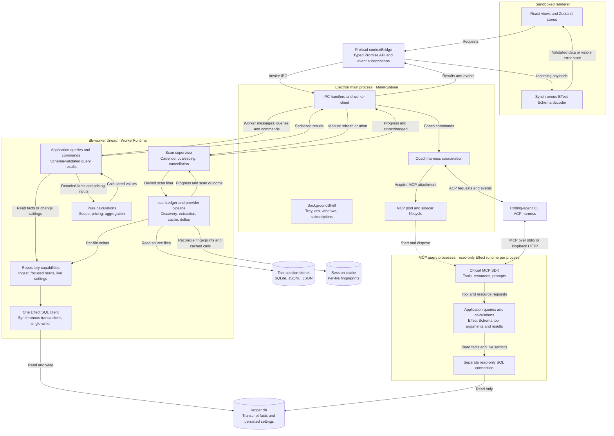

# Watchtower architecture

The main process owns the application control plane. The db-worker owns the
data pipeline: it discovers and parses tool session files, maintains the
session cache, and writes per-file changes to the local SQLite ledger. Views
derive their results from that ledger at query time.

## App map

Each backend isolate owns its Effect runtime and resources. Solid arrows show
calls, data, and events; dashed arrows show lifecycle ownership. The worker
and MCP processes share application query code, but have separate service
instances and SQLite connections.



The diagram shows the core scan, query, and Coach paths. HTTP pricing/FX
clients, Config, Clock, and the Operational log support the owning runtime
as described [below](#the-effect-first-backend). `BackgroundShell` owns native
UI resources within main and uses the same IPC boundary for renderer data.
For each request arrow, the response returns to its caller; selected result
and event paths are drawn explicitly.

### Following a request through the app

1. A manual refresh enters through the preload API and main's worker client.
   The worker supervisor coalesces it with any active scan and owns the scan
   fiber. `scanLedger` composes provider discovery, parser streams, cache IO,
   and per-file ingest. Provider records pass extraction Schema validation;
   malformed declared fields increment the provider's `unparsed` count.
   The first scan covers lifetime history. Later scans reuse fingerprints
   and cached calls, while each changed file commits atomically to the ledger.
2. The worker sends progress and completion events to main for relay.
   `store:changed` triggers the renderer's existing refresh flow. A section's
   data request travels through the Promise IPC API to an application query
   in the worker. That query obtains decoded facts and live settings through
   a focused repository capability, runs pure calculations, and validates
   the outgoing payload with Effect Schema. Main forwards the result and the
   renderer decodes it again before updating its store.
3. An Alias or Price override edit follows a worker command route into
   `LedgerConfig`. Subsequent queries use the updated setting to reprice the
   existing facts. The edit requires no transcript rescan. Each repository
   operation completes its SQLite transaction without Promise yields.
4. A Coach request goes to main's harness integration. The coding-agent CLI
   can call `watchtower-ledger` tools over MCP to inspect usage. Each MCP
   query process owns a read-only connection and reuses the application query
   code with its own service graph. The SDK owns protocol handling; Effect
   Schema owns Watchtower's tool arguments and result contracts. Tool scopes
   default to lifetime and can differ from the current dashboard scope.
5. Cancellation and shutdown belong to the runtime that owns the work.
   Scoped fibers and finalizers release scan, harness, shell, and sidecar
   resources. Expected operational failures stay typed inside Effect until a
   worker, IPC, or SDK adapter translates them. A malformed renderer result
   becomes an error state; a malformed broadcast is dropped by the tripwire.

To trace these paths in source, start with the
[worker supervisor](../src/main/db-worker/entry.ts),
[scan application](../src/main/application/scan-ledger.ts),
[query dispatcher](../src/main/db-worker/query-dispatch.ts), and
[Overview query](../src/main/application/overview-query.ts). The
[MCP query runtime](../src/main/agents/ledger-mcp/query-runtime.ts) shows how
the same application queries run with a separate read-only service graph.

## Data flow

```
tool stores on disk (SQLite / JSONL / JSON)
        │  discovery: probe known paths per provider
        ▼
   extraction  : provider parsers read foreign blobs into parsed call records
        │       sealed by a shared Effect Schema: unknown keys stripped, a
        │       declared field failing its type is skipped and counted as
        │       "unparsed". A provider schema drift degrades that provider,
        │       never the whole scan.
        ▼
   session cache  : per-file fingerprints (dev/ino/mtime/size) reconcile what changed
        │
        ▼
   port-in  : per-file deltas stream into the ledger, upserted by a stable key
        │       (source_file, sessionId, dedupKey); re-ports are idempotent
        ▼
      ledger (SQLite)  : raw transcript facts, nothing materialized
        │
        ▼
   aggregation  : every view re-derives its totals at query time
```

## The ledger

The store is an **accumulating, normalized ledger** of four tables
(`ledger_source`, `ledger_call`, `ledger_turn`, `ledger_session`) holding only
what the transcripts observed: per-call facts with raw token counts and a base
cost, per-turn classification, session facts, and per-source provenance.

Because scans port _deltas_ instead of rewriting snapshots:

- The **first scan is lifetime** (epoch to now), so no file's history is ever
  stranded; later scans only touch files whose fingerprint changed
- A `modified` file is replaced atomically; a durable provider (one that
  union-merges) never loses pruned-span history
- Config changes (aliases, price overrides, currency) repaint views instantly;
  the ledger never stores a computed cost, only tokens plus base price
- Indexes support query-time reads over the accumulating local history

## The extraction seam

Every provider's parsed call record flows through one shared Effect Schema
(`src/shared/schemas/providers.ts`) before it can become a cached call or a
ledger row. Effect Schema is the authority for provider, ledger, cache, and
IPC contracts. The renderer decodes incoming payloads synchronously with
Effect Schema and reports invalid payloads through its existing error state
and tripwire. One UI-only schema module remains plain TypeScript. The renderer
uses no Effect runtime, layers, or services, and its Promise-based IPC facade
and local state flow remain unchanged. The installed MCP SDK still uses Zod
internally; that dependency does not define Watchtower's contracts.

Scan metadata carries per-provider **unparsed** counts, so a vendor's schema
drift is visible in the UI instead of silently corrupting totals.

## The scan loop

The main process sends manual `⌘R`/`Ctrl+R` requests to the db-worker. The
worker also owns background cadence and scan lifecycle. Each scan streams
per-file deltas into SQLite and reports progress and completion to main, which
relays events to the renderer. `store:changed` remains the renderer's only
refetch trigger. There is no renderer polling loop. Scans coalesce, a failed
background scan leaves the last-known data visible, and each scan supports
abort and per-provider progress.

## The coach surface

The **Coach & Skills** section (ADR 0017) is a chat with the user's own
coding-agent CLIs. The main process drives one harness per conversation over
the Agent Client Protocol through a single `HarnessRuntime` seam (ADR 0016): a
data-driven registry of one spec file per drivable CLI (`agents/harnesses/`),
the AI SDK + `@mcpc-tech/acp-ai-provider` wired lazily, and a typed
`CoachEvent` stream the renderer derives into bubbles (text, thinking, tool
notices). Model/mode selection is progressive — the agent's handshake declares
what it supports (ADR 0018). Every run attaches the in-app `watchtower-ledger`
MCP server (ADRs 0019/0020): read-only access to the full lifetime ledger,
filtered by the agent itself through each tool's optional `scope` argument.
There is ONE agent with TWO scopes (ADR 0021) — a coaching question and a
skill request are the same mode-less coach run; the suggested-skill chips on
the welcome screen are plain chat-starters that ask the agent to author a
SKILL.md grounded in the ledger.

## The Effect-first backend

Effect is the composition model for effectful backend workflows in the main
process, the db-worker, and the Harness integration
([ADR 0032](./adr/0032-effect-first-backend-architecture.md)). The backend and
owned Schema migration is complete. Workflows use Effect end to end for
orchestration and effectful dependencies. Pure parsing, mapping,
aggregation, and formatting stay ordinary functions.

`effect`, `@effect/platform-node`, and `@effect/sql-sqlite-node` are pinned to `4.0.5`.
[ADR 0034](./adr/0034-effect-schema-contract-authority.md) defines contract
authority. The [adoption plan](./plans/effect-target-architecture.md#stable-ecosystem-adoption-2026-10-19)
links the stable ecosystem migration and its verification. Earlier dated entries
describe the original backend and Schema adoption.

### Current ownership

The main process owns windows, IPC, harness coordination, and the pooled MCP
sidecar lifecycle. Its `MainRuntime` composes those services with HTTP,
configuration, logging, metrics, and tracing. The db-worker owns the scan
pipeline, cadence supervisor, initialized Effect/SQL graph, and single-writer
SQLite connection. It keeps database work off the Electron main thread. MCP
query processes use a separate read-only runtime and connection; they never
share the worker's SQLite state.

The Electron root also composes `BackgroundShell` into that same runtime.
Its scoped Layer owns the tray, orb windows, IPC and display subscriptions,
and delayed visibility, readiness, reveal and peek work. Native callbacks enter
scoped fibers through Effect's `FiberMap` bridge; delays and held-request age
use the captured Clock. Quit blocks new shell activity, interrupts pending tray
acquisition and delayed work, then runtime disposal releases subscriptions and
windows. The first-close explanation is consumed only when its panel appears.
Shell preferences retain their existing `shell-preferences.json` representation,
with a Schema-derived contract and typed read, decode and write failures.

Effect owns backend orchestration, service composition, typed failures,
scoped resources, fibers, schedules, and time-dependent policy. Provider IO and
session-cache IO use native Effects; pure parsing and transformations remain
plain functions. Node's SQLite driver is synchronous, so each repository
operation executes its complete transaction without Promise yields. Effect
does not make an individual SQL statement non-blocking. External Node,
Electron, SDK, and Promise APIs remain leaves at their existing boundaries.

The 23-module owned-schema baseline has no Watchtower-owned Zod contracts:
22 modules use Effect Schema and one UI-only module uses plain TypeScript.
Renderer validation is synchronous and needs no application runtime. The
official MCP SDK may retain its own Zod protocol schemas. Providers expose one
Effect discovery operation and one parser Stream. Parser, registry, cache and
file-read tests run those native operations through test adapters. Framework,
SDK and IPC adapters remain at their external boundaries.

Effect Logger, Metric, and Tracer use the existing sanitized operational-log
writer. Main and worker have separate in-memory metric registries. The worker
forwards records to main through its existing event channel. No exporter or
second logging sink is installed.

### Application workflows and repository boundaries

`src/main/application/` contains query and command workflows. They compose
focused capabilities such as `LedgerViewReads`, `LedgerSessionReads`,
`LedgerExportReads`, `LedgerIngest`, and `LedgerConfig`. Repository
implementations are focused capability layers that resolve the isolate's existing
SQL client. They do not construct a connection or an intermediate repository
runtime. Section queries and exports load the facts and live settings their calculations require in one
transaction, then pass decoded data to pure `*-calculation.ts` functions.
Application queries validate outgoing payloads with Effect Schema. MCP tools
reuse the application queries through their process's Promise adapter.

Expected operational failures stay in Effect's typed error channel until the
worker, IPC, or SDK adapter translates them. Scoped resources and fibers own
cleanup and cancellation. Runtime construction and `run*` calls belong at
composition roots and external adapters. Effect values, services, and fibers
never cross IPC.

### Configuration and platform IO

Environment configuration uses Effect Config. Main and worker startup capture
`AppPaths` for synchronous path helpers; Effect consumers use the `Env`
service or operation-time Config reads. Persisted settings, including Aliases
and Price overrides, stay in the ledger's `LedgerConfig` capability. Clock
controls time-dependent policy, allowing tests to substitute `TestClock`.

HTTP uses `effect/http`; the `CommandRunner` port uses
`effect/process` with the official Node spawner. Main and worker supply the
FileSystem, Path, and process services through `NodePlatformLive`. Standalone
auth probing uses an explicit adapter over the same default layers. Skills saves
and protected exports, cache persistence and refresh locks use FileSystem.
Export symlink inspection retains a native no-follow leaf because the portable
stat API follows links. Cache fingerprinting retains native numeric stat fields
to preserve the existing persisted representation. Each noncancellable file
operation settles before interruption completes. Polling sleeps remain
interruptible. See
[ADR 0035](./adr/0035-official-effect-platform-implementations.md).
Synchronous discovery helpers may use `node:fs`;
effectful, streamed, retryable, or scope-owned file work goes through an owned
capability. Provider discovery and parser streams compose in the scan fiber.

Provider and parser types declare their service requirements. Providers without
a filesystem dependency retain their narrower types; the scan registry composes
providers that need FileSystem with the worker's existing platform layer.
`jsonl-parser.ts` owns pure string and Buffer scanning, while
`cache-refresh-coordinator.ts` owns refresh locking, authoritative reload,
read-only fallback and release. The parser retains canonical assembly and shared
deduplication.

The session, Codex and Cursor cache writers share `cache-file-write.ts` for
staging and closing a file before publication. Expected filesystem close failures
stay typed so existing cache fallbacks can recover. Operation failures,
unexpected release defects and interruption keep their causes. Native handle
tests check `EBADF` after close and before rename.

HTTP callers consume status and an Effectful JSON decoder from one HttpClient
implementation. The deadline covers response headers. Body decoding follows
the status check, and caller cancellation applies to both phases. Retries cover
transient request failures; status and decode fallbacks stay with their callers.

ESLint uses the official Effect plugin for subpath imports and a TypeScript
resolver for repository import boundaries. The separate `lint:effect` gate
uses official semantic diagnostics with positive and negative fixtures.
Application runtime ownership remains a repository rule. Effect-aware tests use
`@effect/vitest`; specialized virtual-clock windows and real-time hang bounds
remain where they test cancellation or retries.

## Architecture decisions

Key decisions are recorded as ADRs in [`docs/adr`](./adr) and referenced
inline in the code. The most relevant ones:

- [ADR 0002: the ledger is an accumulating store of raw facts; every view is a query-time derivation](./adr/0002-accumulating-ledger-query-time-aggregation.md)
- [ADR 0003: shared Effect Schema contracts and extraction that tolerates provider drift](./adr/0003-shared-zod-schemas-extraction-seam.md)
- [ADR 0004: lifetime delta scans and the single `store:changed` refetch trigger; worker ownership follows ADR 0023](./adr/0004-lifetime-delta-scans-single-refetch-trigger.md)
- [ADR 0005: sandboxed renderer, a typed IPC surface, a frozen wire contract, and a renderer-side tripwire](./adr/0005-sandboxed-renderer-ipc-tripwire.md)
- [ADR 0009: USD-anchored store; currency conversion only at the display/export boundary](./adr/0009-usd-anchored-fx-boundary.md)
- [ADR 0012: local-first privacy, no telemetry, manual informational updates](./adr/0012-local-first-privacy-manual-updates.md)
- [ADR 0015: cross-platform packaging and CI](./adr/0015-cross-platform-packaging-and-ci.md)
- [ADR 0016: data-driven harness registry and the ACP runtime seam](./adr/0016-data-driven-harness-registry.md)
- [ADR 0017: unified Coach & Skills section](./adr/0017-unified-coach-skills-section.md)
- [ADR 0018: ACP-real harness spec and progressive model/mode selection](./adr/0018-acp-real-harness-spec-and-progressive-selection.md)
- [ADR 0019: in-app ledger MCP server and per-conversation temp workspace](./adr/0019-in-app-ledger-mcp-and-temp-workspace.md)
- [ADR 0020: ledger MCP on the official SDK and shared seam](./adr/0020-ledger-mcp-on-official-sdk-and-shared-seam.md)
- [ADR 0021: one coach agent, two scopes — build-skill deleted, skills crafted conversationally](./adr/0021-single-coach-agent-two-scopes.md)
- [ADR 0025: ledger MCP HTTP fallback for stdio-rejecting harnesses](./adr/0025-ledger-mcp-http-fallback-for-stdio-rejecting-harnesses.md)
- [ADR 0026: pooled ledger MCP sidecar for stdio-rejecting harnesses](./adr/0026-pooled-ledger-mcp-sidecar.md)
- [ADR 0027: app-scoped local ledger MCP and startup controls](./adr/0027-app-scoped-local-ledger-mcp.md)
- [ADR 0030: original Coach harness adoption; scope superseded by ADRs 0032 and 0034](./adr/0030-effect-for-harness-management.md)
- [ADR 0031: version the local ledger schema with SQLite migrations](./adr/0031-versioned-ledger-migrations.md)
- [ADR 0032: Effect as the composition model for backend workflows](./adr/0032-effect-first-backend-architecture.md)
- [ADR 0034: Effect Schema as the contract authority](./adr/0034-effect-schema-contract-authority.md)
