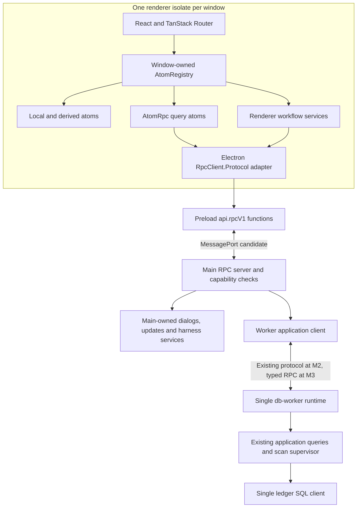

# Effect renderer and RPC adoption plan

Status: implementation in progress in [PR #175](https://github.com/Pasquale-Favella/watchtower/pull/175), tracked by [issue #174](https://github.com/Pasquale-Favella/watchtower/issues/174). The original assessment used checkout `5187054df75a5bbd98ccbb81e82469b762d5ad7b` on 2026-10-22. Read [the accompanying research](../research/effect-renderer-adoption-2026-10-22.md) for findings and upstream references. Current verification evidence belongs in the issue and PR.

This file is the technical adoption sequence. GitHub remains the authority for executable issues and PRDs under [the issue-tracker convention](../agents/issue-tracker.md). Slice IDs identify review boundaries within #174. ADRs 0036 and 0037 authorize the renderer and versioned RPC changes. The completed backend migrations #148 and #156 remain closed.

## Intended result and scope

Use Effect as the composition model for renderer effects and shared state. Remove Zustand. Use shared Effect Schema RPC contracts for renderer/main requests and, in a later independent milestone, main/db-worker requests. React still owns rendering, local form interaction, dialogs and hooks. TanStack Router still owns route identity and performs no data loading.

Completion has three milestones:

| Milestone | Observable outcome                                                                                                                                                    | Required slices                       |
| --------- | --------------------------------------------------------------------------------------------------------------------------------------------------------------------- | ------------------------------------- |
| M1        | No Zustand in production or tests; one Atom registry per window; shared renderer state and workflows use Atom and scoped Effects over the existing bridge             | S0 through S7                         |
| M2        | Application queries/commands and owned event streams cross a versioned Effect RPC boundary between renderer and main; AtomRpc replaces migrated bridge-backed queries | S8 through S11, after M1              |
| M3        | Main/db-worker application requests also use typed RPC contracts and official Node worker transport while preserving Watchtower's supervisor and consistency policies | S12, after its own compatibility gate |

M1 is a useful release by itself. M2 establishes native RPC on the renderer/main hop. Only M3 can claim that errors remain typed through the worker hop. M3 is part of the proposed full cross-process destination, but a worker transport problem must not hold the Zustand removal hostage.

Do not include a database redesign, provider-parser rewrite, ACP replacement, remote backend, route loaders, a second SQL pool, or new update polling in this adoption. The in-app ledger MCP connection serves harness clients and keeps its existing official SDK ownership. It is not the renderer's RPC transport.

## Architecture and ownership

The target request path is:

Events return through an explicit window-owned subscription. Each window invalidates its own reactive queries. Main continues to route application-wide scan/config/currency events to eligible windows, and Coach events to their owning window and run.

| Owner                | Responsibilities                                                                                                          |
| -------------------- | ------------------------------------------------------------------------------------------------------------------------- |
| Renderer window root | Registry, one Atom runtime factory, browser adapters, event-consumer scopes, bootstrap and disposal                       |
| React component      | Read atoms; dispatch commands; retain interaction-local state where appropriate                                           |
| Preload              | Fixed bridge capabilities, Electron adaptation, port/listener lifetime, no business state or SQL                          |
| Main runtime         | Window and sender identity, native capabilities, RPC server lifecycle, worker supervisor and harness ownership            |
| Db-worker runtime    | Ledger, complete synchronous SQL operations, scans, cadence, pricing/FX persistence and application queries               |
| Shared modules       | Schema contracts, derived wire types, RPC declarations and pure helpers; no renderer, Electron or Node capability imports |

Use `Atom.context()` once per window root and share it with workflow atoms and AtomRpc services. Let the registry own its Layer memo map and Reactivity service. Do not add a second renderer ManagedRuntime just to execute event invalidation. Imperative Electron/browser callbacks enter Effects through the root's adapter or command dispatch mechanism.

The React binding supports an existing registry through `RegistryContext`; use an explicitly owned registry when bootstrap/wiring also needs it outside component hooks. Establish ownership before rendering. StrictMode's effect setup/cleanup/setup must not create two live connections, run two initial scans, or dispose a registry that a remounted hook still uses. Use scoped, idempotent start/stop operations and test that actual sequence. HMR and real window unload need disposal too.

## Decisions to record before implementation

S0 should introduce two concise proposed ADRs, accept them as implementation begins, and amend the affected guidance with links. Do not silently remove accepted constraints from older ADRs.

| Decision               | Proposed content                                                                                                                                                                                           | Existing decisions affected                                                          |
| ---------------------- | ---------------------------------------------------------------------------------------------------------------------------------------------------------------------------------------------------------- | ------------------------------------------------------------------------------------ |
| Renderer composition   | Atom owns shared state; window-owned Effect composition owns workflows/subscriptions; React owns rendering/local interaction; router owns navigation; preserve query/event behavior                        | 0011, 0032, renderer-runtime clauses in 0005 and 0034; development/architecture docs |
| Versioned RPC boundary | New explicit renderer RPC capability; authoritative shared schemas and encoded messages; permitted operations per window; legacy compatibility during migration; worker RPC remains a separately gated hop | Frozen-wire clauses in 0005 and 0023, plus 0034's representation rules               |

ADRs 0004, 0009, 0012, 0013, 0014, 0015 and 0035 retain their product and ownership constraints. The renderer decision must clarify that event invalidation replaces the refresh tick without introducing polling. UI runtime adoption changes a previous boundary decision; the user-requested research is not itself an accepted wire-format revision.

No domain meaning changes. Continue to use Scope, Section, Alias, Price override, Harness and Coach & Skills as defined in `CONTEXT.md`. Implementation terms such as registry and protocol version do not belong in that glossary.

## Dependency and import policy

- Add exact `@effect/atom-react: 4.0.5`. Resolve its scheduler peer explicitly against the installed 0.27.0 and declare it directly if required by the selected installation policy. Preserve exact alignment of existing Effect packages. Verify a fresh `npm ci` and a single Effect installation.
- Use installed 4.0.5 APIs and production subpath imports, including `effect/reactivity/Atom`, `AtomRegistry`, `AsyncResult`, `Reactivity`, `AtomRpc` and `effect/rpc/Rpc`, `RpcGroup`, `RpcClient`, `RpcServer`.
- Follow `docs/agents/effect.md` and read the complete installed Effect guide before implementation. Return composed Effects from workflow services; keep execution at adapters and roots. Keep pure reducers, selectors, formatting and calculations as functions.
- Extend the existing lint composition-root allowlist with the narrow renderer root/adapters. Keep resolved import boundaries forbidding renderer imports of Node, Electron, main or preload implementation modules. Shared RPC code imports schemas and Effect definitions only.
- Upgrade React bindings and Effect together through reviewed dependency changes. An unstable API label still matters on a stable package version.

Proposed module locations are `app/renderer-runtime.ts`, `app/atoms/`, feature-local `atoms.ts` and focused workflow modules, `shared/lib/bridge.ts`, `shared/lib/preferences.ts`, `shared/rpc/` and `src/main/rpc/`. Keep the existing naming if a slice needs less movement. Avoid a generic abstraction layer that re-exports the entire Atom API.

## State mapping and query identities

| Existing state                               | Proposed owner                                         | Identity/lifetime rule                                                                            |
| -------------------------------------------- | ------------------------------------------------------ | ------------------------------------------------------------------------------------------------- |
| Scope and palette                            | Writable and derived atoms                             | Window lifetime, transient; default period seeded after preference hydration                      |
| Overview, Spend, Models, Pull Requests       | Runtime query atoms, later AtomRpc                     | Operation plus normalized Scope                                                                   |
| Sessions list                                | Query atom                                             | Full Scope                                                                                        |
| Session detail                               | Query atom plus route selection                        | `sessionId` and optional `sourceId`; preserve missing-source semantics                            |
| Compare                                      | Pair selection plus query atom                         | Scope and ordered pair; preserve server-selected default pair                                     |
| Optimize findings and delivery evidence      | Separate query atoms                                   | Scope and operation; delivery evidence activated only on use                                      |
| Skill detection                              | Query atom                                             | Scope, frequency and spread; dismissal events invalidate it                                       |
| Alias/Price override lists and usage pickers | Query atoms and derived selectors                      | Config lists unscoped; usage picker uses lifetime models; lazy activation                         |
| Settings info/providers and MCP settings     | Query atoms plus explicit commands                     | Lazy pane activation; connection credentials read on demand without general query-cache retention |
| Local preferences                            | One persisted preference atom or cohesive atom group   | Same `watchtower:settings` storage envelope and six persisted fields                              |
| Cadence/currency/options                     | Worker-backed queries/commands and currency snapshot   | Not local preference persistence; USD remains the calculation anchor                              |
| Scan state                                   | State atom updated by lifecycle consumer               | Window lifetime; job itself remains application-wide in worker                                    |
| Updates and exports                          | Existing state machines held in atoms; Effect commands | Request IDs/revisions and explicit command admission retained                                     |
| Coach & Skills conversation                  | Cohesive reducer/state atom plus scoped service        | App-window lifetime, selected harness/session/run identities                                      |
| Orb placement                                | Main-fed atom                                          | Main owns geometry, opening/folding and timing                                                    |
| Orb panel                                    | Two Overview query members                             | Exactly `today` and `30days`; first-load and ready notifications retained                         |

Build normalized query input with a small pure function using declared fields. Preserve current period meanings, optional provider/range semantics, source identity, ordered Compare pairs and effective detection thresholds. Do not equate `all` and `lifetime` by assumption. Keep decode/encode representations distinct.

The initial remote-data policy should match today's bounded state. Each activated feature slice retains at most its current request member for the window lifetime. Switching its Scope/pair releases the previous member and starts a fresh load. An unopened slice is never activated. Two orb slices are two distinct slots. This preserves the current behavior in which previously opened sections can refresh after navigation, without retaining every visited Scope.

Release obsolete members with no idle retention and remove the slot's previous-value association. A rapid A/B/A switch must not redisplay an old family member as already fresh. Test this with the registry's actual disposal scheduling. If another active consumer legitimately retains the same member, preserve its data ownership and apply an explicit refresh/display policy for the switching consumer.

Do not add a multi-Scope retained cache or a default 30-second TTL in the first migration. An observer-only refresh policy or bounded revisit cache can be a later product change with its own call-count and memory evidence. If a query family uses idle retention, document that duration as disposal policy, not data freshness.

### Display states and race policy

| Situation                                  | Required UI behavior                                                                                               |
| ------------------------------------------ | ------------------------------------------------------------------------------------------------------------------ |
| First request pending                      | Existing loading state/skeleton                                                                                    |
| Successful null result                     | Existing empty/no-ledger state; not a decode failure                                                               |
| Same identity refreshing                   | Continue showing the last good payload                                                                             |
| Same identity refresh fails                | Keep last good payload and show the existing error treatment                                                       |
| New Scope/pair/detail identity             | No payload belonging to a different identity                                                                       |
| Superseded query resolves late             | Cannot update the currently selected identity                                                                      |
| Same identity invalidated during a request | The displayed settled result must include the intervening change, or a subsequent revalidation must remain pending |
| Malformed incoming result                  | Visible safe contract error; never render undecoded data                                                           |
| Malformed broadcast                        | Drop it, preserve last good state and emit the bounded label/path-only Operational log notice                      |

Use small selectors over AsyncResult rather than duplicating a second `data/error/loading` store. The last-good-data selector must inspect `previousSuccess` on refresh failures. A global Suspense fallback around all Sections would reintroduce loading flashes; do not make that a prerequisite.

Preserve worker revision fencing and cross-window coalescing independently of renderer query cancellation. An interrupted Promise adapter stops observation; it cannot claim to interrupt a remote invoke or synchronous SQL. Test the same-identity invalidation race explicitly instead of assuming Atom's cancellation solves every old refresh race.

## Invalidation and event policy

At first, event sources remain the existing validated subscriptions. Convert their ownership to scoped consumers and feed the same Atom runtime factory used by queries. For a migrated event category, select exactly one authoritative source per window. The migration must not consume both its legacy broadcast and its RPC stream.

| Authoritative input                | Renderer effect                                                                                                             |
| ---------------------------------- | --------------------------------------------------------------------------------------------------------------------------- |
| `store:changed`                    | Update scan metadata/provider hydration and invalidate a broad `ledger` dependency for every activated ledger-derived query |
| `config:changed`                   | Invalidate `pricing` and config lists; all pricing-dependent analytics register that dependency as well as `ledger`         |
| `currency:changed`                 | Replace the active display-currency snapshot and repaint money; do not refetch all USD analytics                            |
| Scan progress/error/idle           | Update lifecycle state only; no analytics refresh on every progress tick                                                    |
| Skill dismissal success            | Invalidate detection after authoritative completion                                                                         |
| Local detection thresholds changed | Select a query with the new effective threshold identity; retain lazy activation                                            |
| Update status                      | Apply only newer updater revisions; do not request a network check                                                          |
| Harness list changed               | Reconcile selected harness and probe cache using existing rules                                                             |
| Orb placement/app navigation       | Mirror main-owned placement or call the existing navigation entry point                                                     |

Use one broad ledger key initially. Add narrower keys only where dependency evidence supports them. A pricing change affects Overview, Models, Spend, Sessions, Compare, Optimize, detection, picker lists and the orb. Invalidating only a Models query would leave other money views stale.

Keep worker broadcasts authoritative for cross-window config writes. Do not both attach AtomRpc mutation invalidation and process the same config broadcast without a deduplication policy. The initial policy is to rely on the authoritative event for config-dependent queries. Convert the current pricing `afterWrite()` refresh into a wait for, or join with, that same refresh cycle before reporting the affected list settled. Do not retain a second list-fetch path permanently. If correctness requires fallback after a missed event, make it one coalesced refresh with a documented deadline, not polling.

Metadata hydration must not strand data invalidation. Current `applyChange()` returns early when status decoding fails; S3 should make invalidation independent of the metadata read while preserving its visible error and provider-list behavior. This is a deliberate resilience correction to record and test. A failed background scan still leaves the last good analytics visible, and an abort is not reported as a successful completed scan.

For M2, define a snapshot-plus-events subscription with a main-owned monotonic revision, or an equivalent subscribe-before-snapshot barrier with replay. Register the subscriber before capturing its initial state and buffer events until the snapshot is delivered. Revision scope and reconnect behavior must be explicit. The existing worker `dataRevision` is internal and is not automatically a renderer event cursor. A reconnect performs one authoritative rehydration and invalidation; it does not replay commands.

Preserve the current Clear data command's successful clear followed by a rescan. It is not selective deletion or retention work from issue #165. A retained query cache must not later resurrect a pre-clear snapshot. M1 resets the initiating window's ledger query members at successful clear and follows the existing cross-window scan events. M2 should include an explicit reset generation in its versioned event/snapshot contract so every window can discard ledger-derived cached values and reject pre-reset responses before rebuilding. Reset handling cannot use ordinary stale-while-revalidate to keep an obsolete session detail visible indefinitely. Test clear during a read and failed rescan separately.

Bound streaming buffers. Scan progress may coalesce superseded progress values, but completion/error/config events must survive. Coach deltas must preserve order and terminal messages; fail a slow consumer visibly rather than silently dropping text. If the harness SDK cannot be backpressured, document the bounded adapter's failure policy. Transport acknowledgements do not automatically bound upstream event producers.

## Preferences and browser resources

Keep the `watchtower:settings` key and existing Zustand JSON envelope readable during migration, including its `state` object and version representation. Persist only theme, default period, onboarded, skills frequency, skills spread and the harness API-key passthrough flag. Never persist actual keys, conversations, query caches, active currency or server cadence as part of that envelope.

Inject a browser preference adapter with a memory implementation for headless tests. Read and validate synchronously before initializing Scope and painting theme. Preserve valid existing profiles, apply defaults for malformed/old values, and tolerate unavailable storage. Do not choose `Atom.kvs` merely for convenience if its storage format or initialization order changes these behaviors. It can be evaluated behind the adapter if compatibility is demonstrated.

Storage events update other windows and do not echo writes back into a loop. Changing persisted default period must not reset an already active transient Scope in another window. Theme changes should reach beacon and panel without loading Coach or ledger queries. Test old-profile hydration, missing/corrupt storage, cross-window updates and immediate first render.

Replace the mutable display-currency singleton with an explicit reactive snapshot and pure formatters accepting currency, or a narrow compatibility adapter while call sites migrate. Formatting-only consumers must subscribe to the currency change. Remove the second mutable owner by M1.

## RPC contracts and error policy

Partition contracts by capability rather than creating one giant group accessible to every window:

- Analytics reads reuse Overview, views, Sessions, Spend, Models, Compare, Optimize, Yield and Skills schemas.
- Config commands reuse Alias/Price override, cadence, currency, dismissal and settings schemas.
- Main capabilities cover updater, export dialogs, protected skill saving, ledger-MCP configuration/credentials and external-link actions.
- Coach operations cover harness detection/inspection/login, starting/cancelling/resetting a run, and the run event stream.
- Native shell/orb commands remain explicit bridge adapters where they carry Electron frame/lifecycle semantics. The renderer calls them through Effect services. Document every retained legacy method so M2's completion claim is precise.
- Worker contracts are separate from renderer contracts. Startup/shutdown, internal paths and maintenance operations are never exposed to a renderer merely because main can call them.

Reuse the authoritative success and field schemas in `src/shared/schemas`. For new RPC struct payloads, map legacy positional arguments at the compatibility edge. Preserve encoded bytes on old channels. Validate new RPC requests before side effects, and validate results at the renderer trust boundary. A generated typed client does not excuse runtime validation.

Define a small error algebra around decisions the renderer can act on. Candidate categories are unavailable/disconnected transport, invalid contract, refused operation and operational failure. Model cancellation separately for operations whose domain treats it as an outcome. Only introduce more specific domain tags when the owner can preserve them end to end. Before M3, worker string failures can only become a generic worker operation failure; do not infer an error tag by matching message text.

RPC errors must have explicit schemas with safe fields such as operation, code and bounded user-facing message. Keep raw SQL, filenames containing personal data, prompt text, tokens, environment values, MCP credentials, request arguments, stacks and complete Cause trees out of renderer logs and RPC tracing. Preserve the existing single bounded Operational log seam and renderer contract-notice path.

Expected transport unavailability should remain an ordinary visible failure. AtomRpc 4.0.5 provides its protocol layer through `Layer.orDie`; a fallible connection handshake placed directly in that layer would turn an expected startup failure into a defect. Keep connection state/recovery in the transport service, return typed `RpcClientError` outcomes through run/send, or handle root acquisition failure explicitly. Prove startup/disconnect error presentation in S8.

### Command execution and cancellation

Do not let query disposal own an application-wide scan, update installation or a native dialog. A command may continue after its acknowledgement or commit. RPC interruption means interruption of an admitted request fiber; it is not proof that a committed operation rolled back.

| Operation                     | Required policy                                                                                                                        |
| ----------------------------- | -------------------------------------------------------------------------------------------------------------------------------------- |
| Ordinary query                | Supersede/dispose local observation safely; cooperative remote interruption where supported                                            |
| Alias/Price override mutation | Preserve each admitted write; serialize conflicting writes or use distinct keyed executions; authoritative config event drives refresh |
| Scan start                    | Worker owns the app-wide job; losing the initiating window does not abort it                                                           |
| Scan abort                    | Explicit global command with existing bounded drain/recovery semantics                                                                 |
| Export/skill save             | Preserve user cancellation, protected destination rules and native completion/drain semantics                                          |
| Updater                       | Preserve manual check/download/install admission and main-owned progress/revisions                                                     |
| Coach run                     | App-window/session-owned; explicit cancellation waits for the owning backend's completion policy                                       |
| Window navigation/visibility  | Main/router ownership remains unchanged                                                                                                |

Use `AtomRpc.mutation` where one in-flight command per tag is deliberately enforced. For independent simultaneous commands or queued writes, use the client in an explicitly configured workflow and expose its result through atoms. Test double clicks and different model writes; do not assume a shared mutation atom queues them.

## Electron RPC adapter acceptance contract

Preferred candidate: main creates a MessageChannel, binds one side to the authenticated window, and transfers the other side into its isolated preload using Electron `postMessage`. Preload owns the port and exposes fixed `api.rpcV1` functions for connect/send/subscribe/dispose using cloneable frames. Names and signatures are to be fixed by S8's prototype, not copied as an untested code example.

The adapter must satisfy all of these:

1. It works with `contextIsolation: true`, `nodeIntegration: false`, `sandbox: true`, dev URLs and packaged `file://`. No renderer import of Electron/Node and no raw IPC bridge.
2. Main verifies the sender's known webContents, top-level frame and expected app document. It derives window role itself; no renderer-supplied role, client ID or arbitrary channel name is trusted.
3. Each connection has a version and generation. Registration precedes readiness. Reload/close/navigation invalidates the old generation, settles its pending calls and removes listeners. Old frames cannot satisfy new requests.
4. Main applies an explicit operation allowlist per window role. The beacon gets lifecycle/placement capabilities, not ledger reads, MCP credentials, exports or harness commands. The panel gets its required fixed-scope data and shell actions.
5. The client/server Protocol implementations use compatible `codecFor` encoding, validate inbound envelopes/payloads, and report accurate acknowledgement, notification, span and transferable support. Begin without general transferable payloads.
6. Invalid calls fail before native actions; unknown protocol/version/tag, malformed request, malformed success/error/event and unexpected duplicate/late frames have defined outcomes. Malformed subscription data preserves the renderer tripwire behavior.
7. Disposal releases ports, event listeners, registry subscriptions and request fibers. Main owns disconnect queues/client IDs and receives port/window termination. A connection failure cannot leave a permanently pending query.
8. Pending-call and event queues have chosen bounds. Overflow is a typed failure or a documented safe coalescing policy. A slow renderer must not stall the application-wide scan supervisor.
9. Reconnection may retry pure reads after rehydration. It never silently retries a possibly committed command or duplicates a Coach run.
10. Startup failures render a safe error. Expected acquisition errors are not hidden behind AtomRpc's protocol-layer defect conversion.

Keep `ipcRenderer.invoke` as the migration adapter, not as a counterfeit bidirectional protocol. If the port candidate fails a necessary constraint, a fixed-channel bidirectional IPC Protocol adapter is the fallback. Record that result before expanding RPC. No HTTP listener is needed for either option.

## Implementation slices

Every slice should merge with a single data owner for its migrated workflow, focused tests and updated documentation. Slice IDs below provide the dependency order. S8's disposable transport investigation can start after S0 while M1 work progresses, but production RPC adoption waits for the root and event-lifetime rules.

### S0. Record the decisions and executable baseline

Dependencies: none. Proposed tracker label: `needs-triage` until the adoption scope and two ADR decisions are accepted.

Create the parent adoption issue with M1/M2/M3 checklists and link this research. Establish the renderer/RPC ADRs described above. Inventory all preload methods, events, direct `window.api` uses, Zustand imports and `getState`/`subscribe` consumers. Mark each as migrated by a slice or retained native adapter. Record package metadata, current bundles and relevant tests. Do not rewrite old research as though its historical conclusions were always wrong.

Acceptance: accepted scope distinguishes UI adoption from both RPC hops; a channel-to-owner checklist covers every method/event, including credentials, export, updates, Coach reset/cancel and orb drag; the current 214-test baseline remains linked. Gate incomplete questions with `needs-info`; label specified implementation tickets `ready-for-agent` only once their dependencies and acceptance are clear.

### S1. Establish the renderer root and migrate transient state

Dependencies: S0. Files: package manifests/lock, three renderer entry points, root/wiring adapters, Scope/palette consumers, lint rules and boundary tests.

Install the pinned binding; create the window registry/runtime factory and ownership API. Put Scope and command-palette state in atoms. Inject a read-only initial-preferences adapter so persisted default-period initialization works before S5 replaces persistence. Keep that initial adapter backed by the current storage owner for this slice. Migrate all imperative Scope/palette call sites and remove those Zustand stores. Mount only the services each window needs.

Acceptance: correct first Scope, period/range/provider behavior, keyboard and router behavior; two registries are isolated; setup/cleanup/setup has one live owner; process-boundary lint still rejects Node/Electron aliases; no second preference owner. Run relevant Scope/palette/shortcut/navigation tests, web/test typechecks, lint and an Electron root smoke.

### S2. Move the bridge boundary into services and migrate Overview

Dependencies: S1. Files: `shared/lib/api.ts`, schema decoder, new bridge/service adapter, Overview atom/view and tests.

Adapt the existing Promise bridge to typed Effects. Initially reuse validated fetchers at the edge, then move their decoding into the single owned adapter as callers migrate. Do not turn `ApiResult` failure into a successful atom value. Keep the renderer's safe label/path contract errors. Move platform and direct bridge access out of touched stores. Create Overview's active query slot and AsyncResult selectors; remove its old factory instance.

Acceptance: initial/no-ledger/same-Scope refresh/error/new-Scope/late-response behaviors pass against fake services and current bridge fixtures. Actual transport cancellation is not claimed for invoke. An Overview payload is not stored twice. Run existing API/decoder and scoped-store parity cases plus the relevant Electron navigation smoke.

### S3. Move scan/bootstrap and central invalidation into scoped ownership

Dependencies: S2. Files: scan store, shared/app wiring, bootstrap hooks and scan/subscription tests.

Use atoms for lifecycle state and Effect workflows for hydrate/start/abort. Register events before initial reads. Preserve worker activity hydration, provider progress order, scan stages, unparsed totals, Full Disk Access behavior and the app-only first scan. Replace Overview's refresh-listener registration with the shared Reactivity instance. Other unmigrated stores may receive a temporary legacy tick from the same authoritative event adapter; remove that path as they migrate.

Decouple data invalidation from failure of metadata reads as described above. Coalesce overlapping metadata hydration so old bootstrap reads cannot replace newer lifecycle state. Keep successful scan completion, background failure, abort and already-running outcomes distinct.

Acceptance: no renderer timers/polling; a second window opened mid-scan reflects activity; StrictMode does not start duplicate scans/listeners; invalid metadata does not block Overview invalidation; teardown is deterministic. Run scan/subscription/orb lifecycle tests and existing abort recovery tests without changing worker policy.

### S4. Migrate the remaining analytical reads

Dependencies: S3. Files: Sessions, Spend, Models, Pull Requests, Compare and Optimize stores/views, detail route consumers and their tests.

Replace the thin factory stores first, then compound stores. Use independent slots for session list/detail and Optimize findings/delivery evidence. Preserve optional `sourceId`. Compare adopts and retains the server-selected default pair without triggering an accidental redundant request loop. Record that refreshing open session detail is unchanged unless separately specified. Remove `zustand/react/shallow` from each migrated view in favor of appropriate atom selectors.

Acceptance: full identity matrix passes, including A/B/A Scope changes, same-key invalidation in flight, duplicate session IDs from different sources and Compare pair ordering/default adoption. Unopened delivery evidence does not fetch. Pricing still refreshes through the temporary tick until S5. Run corresponding query/view/store/source-aware tests and Section navigation acceptance.

Use separate review units for thin stores, Sessions, Compare and Optimize. They share the infrastructure but each has its own parity gate; do not hold all analytical reads in one large change.

### S5. Migrate preferences, currency and pricing commands

Dependencies: S4. Files: settings/pricing stores, browser preference adapter, currency formatters, Settings consumers and Coach threshold bridge.

Replace Zustand persist with the compatible synchronous preference adapter and atoms. Migrate cadence/currency/options through Effect services. Serialize cadence writes and publish server-confirmed values only; a failed write retains the last confirmed selection. Fence late hydration responses and currency events so stale snapshots cannot overwrite newer confirmed state. Move priced/unpriced calculations to stable derived reads. Replace pricing command execution with explicit admission/serialization and one authoritative invalidation cycle. Remove current post-write duplicate reads only after their immediate picker-update behavior passes. Migrate detection-threshold observation to a root-owned subscription rather than a module-level listener.

Move Settings info/providers reads and MCP settings commands out of component-owned Promise chains into the same services/query model. Preserve conditional Full Disk Access/config-directory behavior, successful clear/rescan ordering, token regeneration and on-demand connection copying. Clear credential-bearing connection data after use and invalidate it on token regeneration. Route direct external-link/system-settings calls through the native-capability adapter. Keep browser-only presentation state in React.

Acceptance: existing user settings survive; transient Scope does not follow subsequent default-period changes; storage unavailable/corrupt cases are safe; other windows repaint theme/currency; no double USD conversion; two admitted model writes both complete; command failure/cancel does not invalidate as success; closed pricing panels remain lazy. Run settings/currency/pricing/scan tests, then relevant Models/Settings/orb acceptance.

Review preferences, currency, pricing and the remaining Settings capabilities as separate vertical changes under this slice. Every intermediate change has one persistence/currency owner and a working bootstrap.

### S6. Migrate Coach & Skills state over the current transport

Dependencies: S5. Files: Coach store/view, harness probe and conversation workflow modules, detection atoms, app event wiring and tests.

Keep the existing event reducer semantics, per-harness cache and workflow policy; replace their Zustand owner and async orchestration. Own the conversation/run scope at the app window, not the Section component. Use native Effects/Streams at that scope while adapting the existing ack and runId-enveloped event bridge. Move cancel/reset into the bridge service. Preserve events that arrive before acknowledgement and stale-event rejection after reset or harness change. Snapshot Scope and passthrough preference per run.

Include `harness-setup.tsx` login-terminal/recheck operations in this service migration. Clipboard copied indicators may remain local React state with their own cleanup.

Acceptance: the complete Coach store baseline passes against the new registry/service test setup: early events, failed/empty probes, switch during probe/run, switch-back cache, terminal errors, cancellation, reset, follow-up and temporary workspace cleanup. Leaving the Section must not unintentionally kill the conversation. No Coach modules enter the beacon bundle. This slice does not change the ACP SDK or claim the ack/event race has disappeared.

### S7. Finish orb, updater and export adoption; remove Zustand

Dependencies: S6. Files: orb state/wiring/hooks, updates/export stores and consumers, remaining shallow selectors, manifests, docs and tests.

Put the existing updater/export state machines in atoms and run commands through scoped services. Retain request/revision fences and native completion behavior. Replace panel/placement stores, preserving exactly two fixed Scope loads and the initial-flight/when-loaded contract. Remove the generic data-store factory, refresh listener set, module-level subscriptions and legacy state adapters when their final callers are gone. Update current architecture/development docs and renderer-runtime lint policy.

Review orb, updater and export as separate changes; remove the dependency in a final cleanup after their tests and the component-owned workflow inventory are complete.

Acceptance for M1: no owned Zustand imports, Zustand test API or manifest/lock entry remains; no second currency singleton; all three window roots use explicit registries; all events have one owner and teardown; stored profiles survive. Application fetchers are called only by the bridge/service adapter, not by component-owned Promise workflows. Run the full core gate and supported Electron/packaged acceptance described below. A narrow explicit native shell bridge is compatible with M1.

### S8. Prove the versioned Electron protocol

Dependencies: S0 for investigation; S1/S3 ownership design for production integration. Files: transport prototype, proposed RPC schemas/groups, preload declarations, main RPC adapter and isolated Electron tests.

Implement a disposable read, one admitted write and one finite/infinite test stream using the real sandboxed preload/main boundary. Meet the ten transport acceptance conditions above. Test the actual schema/serialization path rather than only `RpcTest`. Include custom-schema encoded values and typed error envelopes, interruption/ack frames, close before ready, malformed data and pending-call failure. Verify no leaked client after repeated reload/close.

Acceptance: write a short measured result choosing the MessagePort candidate or fixed-channel fallback; compile and execute in dev and packaged Windows `file://`; exercise the same startup/close tests in supported OS CI before declaring transport production-ready. Metadata/source inspection from this research does not satisfy this gate. Add no production domain migration until the result is known.

### S9. Adopt RPC and AtomRpc for Overview and pricing

Dependencies: M1 and S8. Files: shared analytics/config RPC declarations, main handlers, worker application-client adapter, renderer service/atom implementations and legacy compatibility handlers.

Reuse existing schemas. Main forwards ledger work to the existing worker client through an Effect capability; it does not reconstruct queries or acquire SQL. Replace the Overview service implementation and pricing operations for the pilot. Keep old IPC methods working while any other caller needs them. Use authoritative config events and explicit command admission instead of double invalidation. Add transport failures to existing visible error selectors.

Acceptance: M1 behavior tests pass against both bridge-backed and RPC-backed service implementations; a committed write with a lost acknowledgement is not automatically replayed; schema validation remains at each trust boundary; cross-window config changes update all eligible windows. Remove pilot adapters once the RPC path is selected and verified. Do not call worker string errors domain-typed failures.

### S10. Migrate remaining application requests and lifecycle events

Dependencies: S9. Files: remaining analytics/settings/update/export/MCP/skill RPC groups and handlers, event subscription contract, renderer services and preload manifest.

Move all remaining application reads/commands from the explicit inventory. Keep native dialogs, export protections, updates and credential access under their current main owners. Introduce snapshot/event revision handling and reconnection hydration. Move scan/config/currency/update/harness event categories one at a time; disable the matching legacy source when switching each category. Preserve beacon/panel capability limits and bundle differences.

Acceptance: no event category has duplicate subscriptions; reconnect catches changes during the gap; cold subscribers receive a consistent initial snapshot; malformed events drop safely; buffers stay bounded; currency events repaint without SQL refetch; updater network checks still require a user command. Every application method is marked migrated, or has a specific native-adapter justification and test.

### S11. Move Coach run streaming to RPC and retire legacy application IPC

Dependencies: S10. Files: Coach RPC group/main handlers, app run consumer, event reducer integration, preload and removed legacy fetch paths.

Design one scoped run request/stream whose first event establishes run/session identity before text/tool events. Consume it continuously in the app-owned workflow service; do not expose an unbounded accumulated AtomRpc pull result as the transcript. Keep typed cancel/reset commands and the existing reducer/probe cache. Define how explicit cancellation, window close, connection loss and reset terminate or reconcile the backend run. The backend remains the authority for harness/process/temp-workspace cleanup.

Acceptance for M2: Coach event ordering and terminal semantics pass under fast failure before first payload, cancel while probing/streaming, late terminal events, close/reopen and harness changes. Remove the ack-event parking map only when the single ordered stream proves it unnecessary. Every remaining legacy bridge method is a named native shell adapter with capability tests. Remove obsolete application invoke/event methods, redundant decoding/fetch adapters and compatibility handlers. Run the full gate and three-window packaged acceptance.

### S12. Adopt typed main/db-worker RPC with the official Node transport

Dependencies: M2 for integration; a disposable Node/Electron worker compatibility investigation can begin after S0. Files: worker RPC declarations, NodeWorker/NodeWorkerRunner Layer composition, worker entry/dispatch/client, main forwarding services and worker tests.

First prove `RpcClient.layerProtocolWorker({ size: 1 })` and `RpcServer.layerProtocolWorkerRunner` against the installed platform adapters in Electron and the packaged asar. Configure exactly one worker; do not inherit a multi-worker pool policy. Identify how startup data and ledger-ready acknowledgement fit the platform readiness handshake. Prove normal close and forceful termination ordering before touching production lifecycle code.

Implement handlers by calling existing application Effects inside the existing worker runtime. Move serialization/typed operational error translation to that boundary. Main composes its server handlers with the typed worker client. Share payload schemas where their representation is identical, but keep internal maintenance/startup operations out of renderer groups.

Retain Watchtower's supervisor around the transport. It owns fatal initialization failure, post-ready crash/backoff, no command replay, read coalescing, mutation revision fencing, scan abort drain/recovery and shutdown. Explicitly reconcile its termination policy with NodeWorker's finalizer; only one policy may replace the worker, and a replacement cannot overlap the previous ledger owner. RPC interruption cannot preempt a synchronous SQLite statement.

Acceptance for M3: all worker boot, SQL ownership, query dispatch, stable-read, protocol-error, crash/backoff, abort-recovery and shutdown tests pass; new serialized error round trips retain intentional tags; a malformed request cannot execute SQL; simultaneous windows still share identical reads; writes always execute once when admitted and are never replayed on disconnect. Remove old `{ id, op, args }` correlation/switch plumbing only after parity. Preserve the behavior of all its useful tests rather than deleting them with the implementation. Verify the real packaged worker on each supported target.

If the official transport cannot meet lifecycle policy without adding another competing supervisor, stop this slice at a documented compatibility result and retain the existing typed application adapter over the old wire. Record M3 as incomplete. M1/M2 remain valid outcomes.

## Verification and release gates

The initial owner assessment adds explicit consistency requirements to these gates. A successful ledger event must invalidate queries even when metadata hydration fails. Currency has one reactive owner and pure formatting dependencies. Settings writes must reconcile with persisted state under failure and concurrency. A failed refresh must show a nonblocking error beside any retained payload; it must not silently present that payload as current. Transport acceptance requires real lifecycle, backpressure, role and packaging evidence before selecting RPC in production. Tests for these properties take precedence over counts of converted stores or passing test cases.

Tests should assert user-visible outcomes, request identities and resource ownership. Use a fresh registry per unit test, injected fake bridge/preferences services and deterministic Effect clocks. Most state/workflow tests remain headless; no DOM environment is required merely to replace Zustand. Add a few actual React/Electron tests for the provider/hooks, StrictMode and sandbox boundary. `RpcTest` helps handler tests but bypasses serialization and cannot replace transport tests.

| Gate                      | Evidence                                                                                                                                                               |
| ------------------------- | ---------------------------------------------------------------------------------------------------------------------------------------------------------------------- |
| Per-slice behavioral gate | Existing relevant tests ported to registry/service setup; new cases only for new contracts or uncovered races                                                          |
| Core merge gate           | `npm run typecheck`, `npm run typecheck:test`, `npm run lint`, `npm run lint:effect`, `npm run format:check`, `npm test -- --run`, `npm run build`                     |
| Schema/boundary gate      | Existing authority/parity/tripwire/import/worker-SQL tests plus RPC encoded round trips and sender/capability rejection cases                                          |
| M1 gate                   | Zero Zustand references/dependency; valid old-profile hydration; isolated registries; no duplicate listeners; all Section/shortcut/palette/settings/Coach/orb behavior |
| M2 gate                   | Real sandboxed RPC query/write/stream; connection readiness, malformed frames, close/reload/reconnect and slow-consumer cases; audited legacy-method remainder         |
| M3 gate                   | Exactly one worker/SQL owner, ready/init-error semantics, stable-read and coalescing preservation, crash recovery, bounded abort drain and no write replay             |
| Product packaging gate    | Existing Electron checks and packaging verification for Windows, macOS and Linux; include actual packaged `file://`, preload, worker entry and close/reopen behavior   |

Use `npm run test:e2e` for the supported local Electron entry point and the current CI workflow for the cross-platform matrix. Package metadata changes already select installer checks through `scripts/ci-changes.cjs`. Extend existing workflows with the new integration cases; keep the separate Windows process job and do not treat renderer tests as resolution of unrelated issue #149.

At each milestone, verify with controlled provider fixtures and an isolated profile:

1. Cold boot with no ledger, existing ledger and malformed incoming data.
2. Scope changes during reads, same-Scope refresh and a failing background scan.
3. Pricing writes while multiple Sections/windows have loaded; no unnecessary unopened queries.
4. Beacon/panel/app opening during a scan, repeated panel open/fold and app-window close/reopen.
5. Theme/default-period hydration from an old profile, cross-window storage updates and FX repaint.
6. Coach run/probe/cancel/reset and harness changes, including events before the old acknowledgement path.
7. Export cancellation/success, protected paths, manual updater flow and newer-status revision handling.
8. Renderer reload/connection loss while a query or command is active; worker crash and application shutdown where relevant.

Record bundle size, startup-to-first-paint, number of bridge/worker reads for these scenarios, peak retained query members, listeners after repeated open/close and retained Coach event data. Use current baseline fixtures on the same host; earlier query measurement numbers are historical, not the current performance budget. Agree tolerances from that baseline before a release. No migration stage earns a performance claim merely by using Effect.

## Review, rollback and tracking

Group work by these independently reviewable slices. Each PR explains the changed behavior/owner, removed mechanism, tests and remaining limitation. Keep broad formatting, dependency upgrades and domain changes out of the same diff.

During M1, a feature may use the legacy bridge adapter while its state is already Atom-owned. During M2, a feature can switch back to the bridge-backed service implementation if its RPC migration fails; it does not need two parallel state stores. Keep old channels until the inventory has no callers, then remove them in the retirement slice. Prefer reverting a slice over shipping permanent dual protocols or a user-visible transport setting. No ledger schema change is required, so rollback should not require data migration. Preserve the settings envelope until old-profile acceptance has passed.

The tracker parent should link [the research](../research/effect-renderer-adoption-2026-10-22.md), the accepted adoption ADRs and S0-S12 children with dependency edges. Use native sub-issues/dependencies when available, otherwise explicit parent/blocked-by links per the repository convention. Readiness requires the ticket's input, owner boundaries, removed code, tests and acceptance above to be concrete. Mark unresolved transport or lifecycle choices as research work, not `ready-for-agent` implementation.

Finish the adoption only when the milestone-specific evidence is attached. Do not close the overall full cross-process objective after Zustand removal, and do not represent an in-memory probe as proof of an Electron or packaged-worker boundary.
